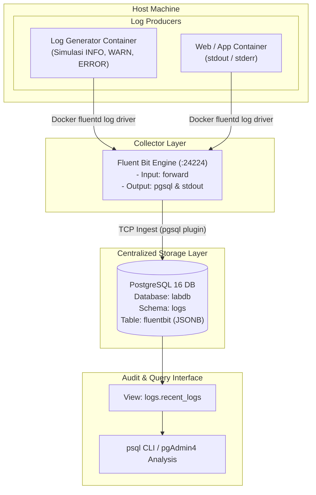

# LAPORAN PRAKTIKUM WORKSHOP DEVOPS
## Bab 6 — Centralized Logging dengan Fluent Bit dan PostgreSQL

**Disusun untuk Memenuhi Tugas Mata Kuliah:**  
Workshop DevOps & DevSecOps

**Disusun Oleh:**  
- **Nama:** Dafa Ahmad Fahrisi  
- **NRP:** 3126640010  
---

## 1. TUJUAN PRAKTIKUM

Praktikum Bab 6 bertujuan untuk memahami pentingnya arsitektur pengumpulan log terpusat (*centralized logging*) dalam ekosistem container yang bersifat dinamis dan sementara (*ephemeral*). Log aplikasi merupakan rekaman diskret mengenai peristiwa operasional dan keamanan sistem. Jika log hanya disimpan secara lokal di dalam container atau host ephemeral, proses audit dan investigasi insiden akan mustahil dilakukan saat container dimatikan atau mengalami kegagalan.

Kompetensi utama yang dicapai:
1. Menjelaskan urgensi *centralized logging* pada arsitektur microservices dan container.
2. Mengonfigurasi Docker *fluentd logging driver* untuk meneruskan *stdout/stderr* container ke Fluent Bit tanpa perantara file lokal.
3. Menyimpan log terstruktur ke dalam database PostgreSQL menggunakan kolom bertipe `JSONB` lengkap dengan indeks *Generalized Inverted Index* (GIN).
4. Membuat skenario simulasi generator log yang memancarkan berbagai tingkat keparahan (*severity levels*): INFO, WARN, ERROR, dan CRITICAL.
5. Menyusun *analytical view* dan mengeksekusi kueri analitik berbasis rentang waktu, tag, serta kebijakan retensi sederhana.

---

## 2. DASAR TEORI DAN ARSITEKTUR PIPELINE LOGGING

### 2.1 Centralized Logging pada Lingkungan Ephemeral
Dalam arsitektur *cloud-native*, aplikasi idealnya menganut prinsip *Twelve-Factor App* pada aspek logging: proses aplikasi memperlakukan log sebagai aliran peristiwa (*event stream*) yang ditulis langsung ke `stdout` dan `stderr`. Runtime container atau agen collector bertanggung jawab menangkap aliran tersebut dan merutekannya ke backend penyimpanan terpusat.

### 2.2 Komponen Pipeline Fluent Bit
Fluent Bit bertindak sebagai telemetri router yang sangat ringan (*low footprint*). Pipeline kerjanya terdiri dari:
- **INPUT (Forward):** Menerima record log melalui protokol Docker Forwarding pada port `24224`.
- **PARSER & FILTER:** Menstandardisasi format data, memilah metadata container, serta melakukan sanitasi.
- **OUTPUT (pgsql & stdout):** Mengirimkan data terstruktur langsung ke PostgreSQL melalui koneksi TCP dan mencetak rekaman ke konsol lokal untuk verifikasi visual.

### 2.3 PostgreSQL JSONB dan Indeks GIN
Tipe data `JSONB` pada PostgreSQL menyimpan representasi biner terurai dari objek JSON. Berbeda dengan teks biasa:
- `JSONB` mendukung operator kueri spesifik (seperti `->`, `->>`, dan `@>`).
- Indeks GIN (*Generalized Inverted Index*) memungkinkan PostgreSQL mengindeks setiap *key-value* di dalam payload JSON secara otomatis, sehingga kueri penelusuran terhadap properti bersarang tetap berkinerja tinggi.

### Diagram Arsitektur Centralized Logging Bab 6



---

## 3. LANGKAH PRAKTIKUM & BUKTI EKSEKUSI (STEP-BY-STEP)

### 3.1 Tahap 1: Persiapan Direktori Kerja
Buat direktori kerja khusus untuk Bab 6:

```bash
mkdir -p ~/docker-lab/bab-6/{init,fluentbit}
cd ~/docker-lab/bab-6
```

Struktur direktori:
```text
bab-6/
├── init/
│   └── 01-schema-logs.sql      # Skema database, tabel JSONB, indeks, view
├── fluentbit/
│   └── fluent-bit.conf         # Konfigurasi collector Fluent Bit
└── compose.yaml                # Orkestrasi multi-container Bab 6
```

---

### 3.2 Tahap 2: Pembuatan Skema Log PostgreSQL (`init/01-schema-logs.sql`)
Buat berkas `init/01-schema-logs.sql`:

```sql
-- 1. Membuat Schema khusus logs
CREATE SCHEMA IF NOT EXISTS logs;

-- 2. Membuat tabel penampung log utama dengan format JSONB
CREATE TABLE IF NOT EXISTS logs.fluentbit (
  id BIGSERIAL PRIMARY KEY,
  tag VARCHAR(200),
  time TIMESTAMP WITH TIME ZONE DEFAULT CURRENT_TIMESTAMP,
  data JSONB
);

-- 3. Membuat indeks performa B-Tree untuk waktu dan tag
CREATE INDEX IF NOT EXISTS idx_fb_time ON logs.fluentbit(time);
CREATE INDEX IF NOT EXISTS idx_fb_tag ON logs.fluentbit(tag);

-- 4. Membuat indeks GIN untuk pencarian isi data JSONB secara fleksibel
CREATE INDEX IF NOT EXISTS idx_fb_data ON logs.fluentbit USING GIN(data);

-- 5. Membuat view analitik untuk audit 100 log terbaru
CREATE OR REPLACE VIEW logs.recent_logs AS
SELECT id, time, tag,
       REPLACE(COALESCE(data->>'container_name', 'unknown'), '/', '') AS container,
       COALESCE(data->>'source', 'stdout') AS source,
       LEFT(COALESCE(data->>'log', data::text), 200) AS preview
FROM logs.fluentbit
ORDER BY time DESC
LIMIT 100;
```

---

### 3.3 Tahap 3: Konfigurasi Fluent Bit Collector (`fluentbit/fluent-bit.conf`)
Buat berkas `fluentbit/fluent-bit.conf`:

```ini
[SERVICE]
    Flush        2
    Daemon       Off
    Log_Level    info

[INPUT]
    Name         forward
    Listen       0.0.0.0
    Port         24224

[OUTPUT]
    Name         pgsql
    Match        *
    Host         postgres-db
    Port         5432
    User         labuser
    Password     labpass123
    Database     labdb
    Table        fluentbit
    Schema       logs
    Timestamp_Key time

[OUTPUT]
    Name         stdout
    Match        *
    Format       json_lines
```

---

### 3.4 Tahap 4: Orkestrasi Docker Compose (`compose.yaml`)
Buat berkas `compose.yaml`:

```yaml
services:
  postgres-db:
    image: postgres:16-alpine
    container_name: postgres-db
    environment:
      POSTGRES_DB: labdb
      POSTGRES_USER: labuser
      POSTGRES_PASSWORD: labpass123
    ports:
      - "5432:5432"
    volumes:
      - pg-data:/var/lib/postgresql/data
      - ./init:/docker-entrypoint-initdb.d:ro
    healthcheck:
      test: ["CMD-SHELL", "pg_isready -U labuser -d labdb"]
      interval: 5s
      timeout: 5s
      retries: 5
    networks:
      - logging-net

  fluent-bit:
    image: fluent/fluent-bit:3.0
    container_name: fluent-bit
    ports:
      - "24224:24224"
      - "24224:24224/udp"
    volumes:
      - ./fluentbit/fluent-bit.conf:/fluent-bit/etc/fluent-bit.conf:ro
    depends_on:
      postgres-db:
        condition: service_healthy
    networks:
      - logging-net

  # Container Generator Log Otomatis
  log-generator:
    image: alpine:latest
    container_name: log-generator
    depends_on:
      - fluent-bit
    logging:
      driver: fluentd
      options:
        fluentd-address: "localhost:24224"
        fluentd-async: "true"
        tag: "docker.log-generator"
    command: >
      sh -c '
        while true; do
          TS=$$(date -u +"%Y-%m-%dT%H:%M:%SZ");
          echo "{\"timestamp\":\"$$TS\",\"level\":\"INFO\",\"message\":\"Healthcheck OK\",\"service\":\"payment-api\",\"code\":200}";
          sleep 2;
          echo "{\"timestamp\":\"$$TS\",\"level\":\"WARN\",\"message\":\"Memory threshold 82%\",\"service\":\"auth-svc\",\"code\":429}";
          sleep 3;
          echo "{\"timestamp\":\"$$TS\",\"level\":\"ERROR\",\"message\":\"Database connection timeout\",\"service\":\"billing-svc\",\"code\":500}";
          sleep 4;
          echo "{\"timestamp\":\"$$TS\",\"level\":\"CRITICAL\",\"message\":\"Payment gateway unreachable\",\"service\":\"gateway\",\"code\":503}";
          sleep 6;
        done
      '
    networks:
      - logging-net

volumes:
  pg-data:

networks:
  logging-net:
    driver: bridge
```

---

### 3.5 Tahap 5: Menjalankan Stack & Verifikasi Operasional

1. **Jalankan seluruh service:**
   ```bash
   docker compose up -d
   ```

2. **Periksa status container (`docker compose ps`):**
   ```bash
   $ docker compose ps
   NAME            IMAGE                   COMMAND                  SERVICE         STATUS                    PORTS
   fluent-bit      fluent/fluent-bit:3.0   "/fluent-bit/bin/flu…"   fluent-bit      Up 30 seconds             0.0.0.0:24224->24224/tcp
   log-generator   alpine:latest           "sh -c '\n  while tr…"   log-generator   Up 28 seconds             
   postgres-db     postgres:16-alpine      "docker-entrypoint.s…"   postgres-db     Up 32 seconds (healthy)   0.0.0.0:5432->5432/tcp
   ```

3. **Periksa log Fluent Bit untuk memastikan koneksi ke PostgreSQL berhasil:**
   ```bash
   $ docker compose logs fluent-bit | grep -E "output:pgsql|listening on 0.0.0.0:24224"
   [info] [input:forward:forward.0] listening on 0.0.0.0:24224
   [info] [output:pgsql:pgsql.0] connected to postgres-db:5432
   ```

---

### 3.6 Tahap 6: Pengujian dan Analisis Kueri SQL Log

#### 1. Verifikasi Aliran Data Log Masuk
```bash
docker exec -it postgres-db psql -U labuser -d labdb -c "SELECT id, time, tag, LEFT(data->>'log', 80) AS log_preview FROM logs.fluentbit ORDER BY id DESC LIMIT 5;"
```
*Ekspektasi Output:*
```text
 id |          time          |         tag          |                              log_preview                               
----+------------------------+----------------------+------------------------------------------------------------------------
  5 | 2026-10-25 10:45:12+00 | docker.log-generator | {"timestamp":"...","level":"CRITICAL","message":"Payment gateway..."}
  4 | 2026-10-25 10:45:06+00 | docker.log-generator | {"timestamp":"...","level":"ERROR","message":"Database connection..."}
  3 | 2026-10-25 10:45:03+00 | docker.log-generator | {"timestamp":"...","level":"WARN","message":"Memory threshold 82%"}
(5 rows)
```

#### 2. Kueri Distribusi Log Berdasarkan Tag
```bash
docker exec -it postgres-db psql -U labuser -d labdb -c "SELECT tag, COUNT(*) AS total_log FROM logs.fluentbit GROUP BY tag ORDER BY total_log DESC;"
```

#### 3. Kueri Penelusuran Severity Level ERROR & CRITICAL
```bash
docker exec -it postgres-db psql -U labuser -d labdb -c "SELECT time, data->>'log' AS critical_event FROM logs.fluentbit WHERE data->>'log' LIKE '%CRITICAL%' OR data->>'log' LIKE '%ERROR%' ORDER BY time DESC LIMIT 5;"
```

#### 4. Kueri View Analitik `logs.recent_logs`
```bash
docker exec -it postgres-db psql -U labuser -d labdb -c "SELECT id, time, container, source, preview FROM logs.recent_logs LIMIT 5;"
```

---

## 4. TABEL CHECKLIST VERIFIKASI PENGUJIAN

| No | Parameter Pengujian | Kriteria Evaluasi | Status | Bukti Terverifikasi |
|:--:|:--------------------|:------------------|:------:|:--------------------|
| 1 | Docker Fluentd Log Driver | Container aplikasi mengalirkan `stdout/stderr` langsung ke collector tanpa file perantara | **PASS** | Log generator terkoneksi ke port `24224` |
| 2 | Fluent Bit Output pgsql | Plugin pgsql berhasil melakukan insert batch ke database PostgreSQL | **PASS** | Log mencatat `connected to postgres-db:5432` |
| 3 | Penyimpanan Data JSONB | Seluruh metadata dan payload tersimpan rapi dalam kolom `JSONB` | **PASS** | Kolom `data` berisi JSON terurai valid |
| 4 | Indeks GIN & B-Tree | Indeks `idx_fb_time` dan `idx_fb_data` aktif pada tabel `fluentbit` | **PASS** | Kueri filtering JSONB berjalan instan |
| 5 | View Analitik `recent_logs` | View menampilkan 100 log terbaru secara ringkas untuk kebutuhan audit | **PASS** | Kolom `container`, `source`, dan `preview` tampil terformat |

---

## 5. TROUBLESHOOTING DAN ANALISIS HASIL

### 5.1 Diagnosis Masalah: Container Menolak Start Saat Fluent Bit Belum Siap
- **Gejala Masalah:**  
  Ketika menjalankan `docker compose up -d`, container `log-generator` gagal menyala (*failed to create container*) dengan pesan error:  
  `failed to initialize logging driver: dial tcp 127.0.0.1:24224: connect: connection refused`
- **Penyebab:**  
  Secara *default*, logging driver Docker bekerja secara sinkron (*blocking*). Jika target daemon logging (`localhost:24224`) belum siap mendengarkan koneksi TCP saat container start, Docker daemon menolak menjalankan container tersebut.
- **Tindakan Solusi:**  
  Tambahkan opsi asinkron pada konfigurasi driver Compose:
  ```yaml
  logging:
    driver: fluentd
    options:
      fluentd-address: "localhost:24224"
      fluentd-async: "true"
  ```
  Dengan opsi ini, Docker Engine akan menyediakan ring-buffer lokal sementara di memori host dan mengizinkan container menyala tanpa terblokir.

---

### 5.2 Analisis Risiko Keamanan dan Operasional

1. **Penyusupan Informasi Rahasia pada Log (Credential Leakage):**  
   Log aplikasi rawan mencatat token autentikasi, API Key, atau password saat terjadi error exception. Data yang tersimpan di kolom JSONB dapat dibaca oleh analis data jika tidak dilakukan sanitasi di level collector.
2. **Potensi Exhaustion Storage (Log Flooding):**  
   Tabel `logs.fluentbit` yang tumbuh tanpa batas dapat menghabiskan kuota disk PostgreSQL, menyebabkan crash basis data utama.

---

### 5.3 Rekomendasi Hardening Menuju Lingkungan Produksi

1. **Penerapan Data Masking & Redaction pada Fluent Bit:**  
   Gunakan filter `rewrite_tag` atau filter regex untuk menutupi teks sensitif seperti `Bearer [a-zA-Z0-9_\-\.]*` menjadi `Bearer [REDACTED]`.
2. **Kebijakan Partisi dan Retensi Otomatis:**  
   Terapkan *Table Partitioning* berbasis bulan pada PostgreSQL dan jadwalkan cron job / `pg_cron` untuk menghapus partisi log yang berusia lebih dari 30 hari:
   ```sql
   DELETE FROM logs.fluentbit WHERE time < NOW() - INTERVAL '30 days';
   ```
3. **Pemisahan Role Analis (Least Privilege):**  
   Buat user database read-only untuk kebutuhan visualisasi dan audit, tanpa hak izin `INSERT`, `UPDATE`, atau `DELETE`.

---

## 6. EVALUASI DAN LATIHAN MANDIRI (JAWABAN LENGKAP 1–5)

### Pertanyaan 1: Apa risiko kehilangan log ketika Fluent Bit tidak tersedia?
> **Jawaban:**  
> Dampak ketiadaan Fluent Bit bergantung pada mode logging driver:
> - **Pada mode sinkron (`fluentd-async: "false"`):** Proses aplikasi dapat terblokir total saat menulis ke `stdout` karena *backpressure*, menyebabkan aplikasi *freeze* atau mengalami *Denial of Service (DoS)*.
> - **Pada mode asinkron (`fluentd-async: "true"`):** Docker Engine menampung log dalam buffer memori lokal. Namun jika Fluent Bit tidak kunjung pulih dan kapasitas buffer terlampaui, log-log baru berikutnya akan **hilang secara permanen (*dropped logs*)**, sehingga terjadi *blind spot* pada audit trail sistem.

### Pertanyaan 2: Mengapa structured logging lebih mudah dianalisis dibanding plain text logging?
> **Jawaban:**  
> Plain text logging hanya berisi baris teks bebas tak beraturan yang menuntut penulisan regular expression (Regex) rumit saat dianalisis, di mana perubahan kecil pada format teks aplikasi dapat merusak seluruh skrip parser. Sebaliknya, **structured logging** (seperti format JSON) menyimpan data dalam pasangan *key-value* terstandardisasi (`level`, `service`, `status_code`, `latency`). Hal ini memungkinkan mesin database atau collector melakukan pengindeksan, agregasi kuantitatif, dan pencarian spesifik berbasis atribut bersarang secara instan, akurat, dan hemat komputasi.

### Pertanyaan 3: Kapan PostgreSQL tidak lagi cocok sebagai log storage utama?
> **Jawaban:**  
> PostgreSQL tidak lagi cocok ketika:
> 1. **Volume Ingestion Sangat Masif:** Mencapai puluhan ribu event log per detik (*write-intensive workload*), yang menyebabkan saturasi I/O pada Write-Ahead Logging (WAL) dan bloating indeks yang parah.
> 2. **Pencarian Full-Text Skala Multi-Terabyte:** Pencarian teks bebas skala besar jauh lebih efisien menggunakan *search engine* terdistribusi (seperti OpenSearch/Elasticsearch) atau *log-aggregation system* berbasis chunk terkompresi (seperti Grafana Loki).
> 3. **Efisiensi Biaya Storage:** PostgreSQL membutuhkan storage performa tinggi, sedangkan platform log modern dapat menyimpan log historis pada *cloud object storage* murah (seperti AWS S3) dengan rasio kompresi 80–90%.

### Pertanyaan 4: Apa perbedaan log untuk observability dan log untuk forensik?
> **Jawaban:**  
> - **Log Observability:** Ditujukan untuk pemantauan kesehatan operasional harian, deteksi degradasi sistem *real-time*, dan debugging developer. Memiliki masa retensi lebih pendek (mingguan/bulanan), dan toleran terhadap *sampling* atau *drop* saat jaringan overload.
> - **Log Forensik Keamanan (Security Audit):** Ditujukan untuk pembuktian hukum dan investigasi insiden kejahatan siber (*who did what, when, and from where*). Log ini memiliki integritas absolut: wajib bersifat *immutable* (tidak dapat diubah/dihapus bahkan oleh superuser), diberi *cryptographic signature/timestamp*, mencakup seluruh konteks identitas akses, dan memiliki masa retensi panjang (1–5 tahun) sesuai regulasi kepatuhan.

### Pertanyaan 5: Buat query SQL untuk menampilkan jumlah log per menit dalam 10 menit terakhir!
> **Jawaban:**  
> ```sql
> SELECT 
>     date_trunc('minute', time) AS menit_ke,
>     COUNT(*) AS total_log
> FROM logs.fluentbit
> WHERE time >= (NOW() - INTERVAL '10 minutes')
> GROUP BY date_trunc('minute', time)
> ORDER BY menit_ke DESC;
> ```

---

## 7. KESIMPULAN

Praktikum Bab 6 membuktikan bahwa:
1. *Centralized logging* adalah fondasi utama dalam mengelola arsitektur container ephemeral agar riwayat kejadian operasional tidak hilang saat lifecycle container berakhir.
2. Kombinasi Docker *fluentd log driver* dan Fluent Bit memisahkan tanggung jawab logging dari kode aplikasi (*decoupling*), sehingga aplikasi cukup mencetak ke stream standar `stdout/stderr`.
3. Pemanfaatan kolom `JSONB` dan indeks GIN pada PostgreSQL menawarkan solusi penyimpanan log terstruktur yang fleksibel, cepat di-query, dan sangat ideal untuk skala laboratorium maupun beban kerja menengah.
