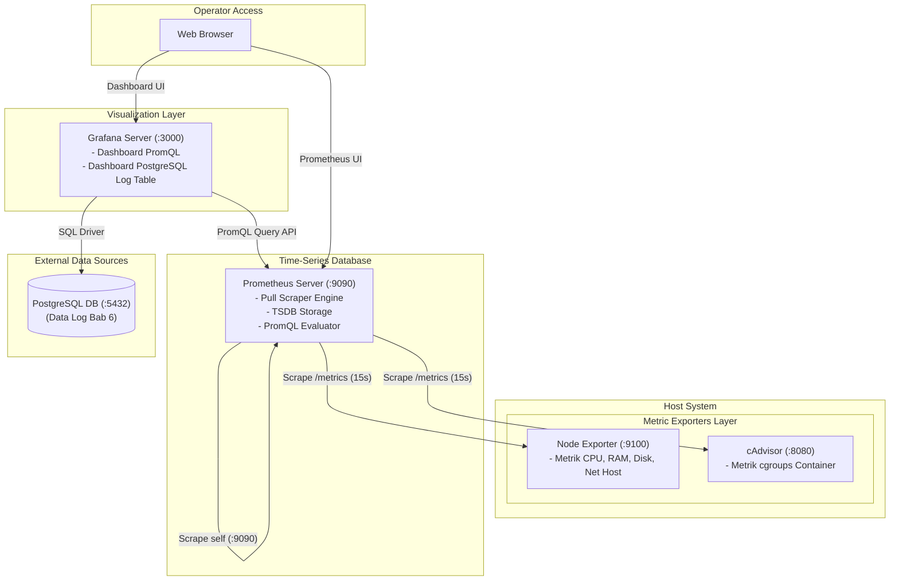

# LAPORAN PRAKTIKUM WORKSHOP DEVOPS
## Bab 7 — Monitoring Resource dengan Prometheus, cAdvisor, Node Exporter, dan Grafana

**Disusun untuk Memenuhi Tugas Mata Kuliah:**  
Workshop DevOps & DevSecOps

**Disusun Oleh:**  
- **Nama:** Dafa Ahmad Fahrisi  
- **NRP:** 3126640010  
- **Program Studi:** D4 Lanjut Jenjang Teknik Informatika  
- **Institusi:** Politeknik Elektronika Negeri Surabaya  
- **Tahun:** 2026  

---

## 1. TUJUAN PRAKTIKUM

Praktikum Bab 7 berfokus pada pilar pemantauan performa dan ketersediaan sumber daya (*resource monitoring*) pada infrastruktur host dan container. Berbeda dengan logging yang menangkap peristiwa diskret, monitoring mengukur tren kuantitatif melalui data numerik deret waktu (*time-series*). Sistem pemantauan yang baik memungkinkan tim operasi mendeteksi tanda-tanda kehabisan memori (*memory pressure*), saturasi CPU, serta kebocoran penyimpanan sebelum memicu *downtime* layanan.

Kompetensi utama yang dicapai:
1. Membedakan karakteristik dan fungsi antara *monitoring metrics* dan *logging events*.
2. Mengonfigurasi dan menjalankan server **Prometheus** sebagai basis data *time-series* berbasis model penarikan data (*pull scrape model*).
3. Mengumpulkan metrik sistem operasi host menggunakan **Node Exporter** dan metrik level cgroups container menggunakan **cAdvisor**.
4. Menyusun kueri analitik **PromQL** untuk menghitung laju perubahan (*rate*), saturasi memori aktual, dan kapasitas disk.
5. Membangun visualisasi dashboard interaktif di **Grafana** serta mengintegrasikan data source eksternal (termasuk PostgreSQL dari Bab 6).

---

## 2. DASAR TEORI DAN ARSITEKTUR MONITORING STACK

### 2.1 Model Pull Scraping Prometheus
Prometheus menggunakan model *pull* (menarik) di mana server Prometheus secara periodik mengirimkan permintaan HTTP GET ke endpoint `/metrics` milik target yang telah ditentukan dalam konfigurasi `prometheus.yml`. Keuntungan utama arsitektur ini adalah kemudahan mendeteksi ketersediaan target (*liveness* via status `up=1` atau `up=0`) serta perlindungan terhadap lonjakan beban (*backpressure control*).

### 2.2 Komponen Monitoring Stack
- **Node Exporter:** Berjalan di level host untuk mengekstrak metrik perangkat keras dan sistem operasi Linux (penggunaan CPU per mode, memori swap, I/O disk, dan statistik jaringan).
- **cAdvisor (Container Advisor):** Utilitas dari Google yang membaca statistik *cgroups* langsung dari Docker daemon (`/var/lib/docker/` dan `/sys/fs/cgroup`) untuk memantau penggunaan resource per container.
- **Prometheus TSDB:** Mesin komputasi dan basis data deret waktu yang menyimpan metrik terkompresi dengan resolusi temporal tinggi.
- **Grafana:** Platform visualisasi dan analitik yang mengubah kueri PromQL dan SQL menjadi grafik garis, panel *gauge*, tabel, dan heatmap.

### Diagram Arsitektur Monitoring Bab 7



---

## 3. LANGKAH PRAKTIKUM & BUKTI EKSEKUSI (STEP-BY-STEP)

### 3.1 Tahap 1: Persiapan Direktori Kerja
Buat direktori kerja khusus Bab 7:

```bash
mkdir -p ~/docker-lab/bab-7/prometheus
cd ~/docker-lab/bab-7
```

---

### 3.2 Tahap 2: Konfigurasi Target Prometheus (`prometheus/prometheus.yml`)
Buat berkas `prometheus/prometheus.yml` untuk mendaftarkan target scrape:

```yaml
global:
  scrape_interval: 15s
  evaluation_interval: 15s

scrape_configs:
  - job_name: "prometheus"
    static_configs:
      - targets: ["prometheus:9090"]

  - job_name: "node-exporter"
    static_configs:
      - targets: ["node-exporter:9100"]

  - job_name: "cadvisor"
    static_configs:
      - targets: ["cadvisor:8080"]
```

---

### 3.3 Tahap 3: Orkestrasi Docker Compose (`compose.yaml`)
Buat berkas `compose.yaml`:

```yaml
services:
  prometheus:
    image: prom/prometheus:latest
    container_name: prometheus
    ports:
      - "9090:9090"
    volumes:
      - ./prometheus/prometheus.yml:/etc/prometheus/prometheus.yml:ro
      - prom-data:/prometheus
    networks:
      - mon-net

  grafana:
    image: grafana/grafana:latest
    container_name: grafana
    ports:
      - "3000:3000"
    environment:
      - GF_SECURITY_ADMIN_USER=admin
      - GF_SECURITY_ADMIN_PASSWORD=admin
    volumes:
      - grafana-data:/var/lib/grafana
    depends_on:
      - prometheus
    networks:
      - mon-net

  node-exporter:
    image: prom/node-exporter:latest
    container_name: node-exporter
    command:
      - '--path.procfs=/host/proc'
      - '--path.sysfs=/host/sys'
    ports:
      - "9100:9100"
    networks:
      - mon-net

  cadvisor:
    image: gcr.io/cadvisor/cadvisor:latest
    container_name: cadvisor
    ports:
      - "8081:8080"
    volumes:
      - /:/rootfs:ro
      - /var/run:/var/run:ro
      - /sys:/sys:ro
      - /var/lib/docker/:/var/lib/docker:ro
    networks:
      - mon-net

volumes:
  prom-data:
  grafana-data:

networks:
  mon-net:
    driver: bridge
```

---

### 3.4 Tahap 4: Menjalankan Stack & Verifikasi Scrape Target

1. **Jalankan container di latar belakang:**
   ```bash
   docker compose up -d
   ```

2. **Periksa status container (`docker compose ps`):**
   ```bash
   $ docker compose ps
   NAME            IMAGE                           COMMAND                  SERVICE         STATUS         PORTS
   cadvisor        gcr.io/cadvisor/cadvisor:latest "/usr/bin/cadvisor -…"   cadvisor        Up 45 seconds  0.0.0.0:8081->8080/tcp
   grafana         grafana/grafana:latest          "/run.sh"                grafana         Up 43 seconds  0.0.0.0:3000->3000/tcp
   node-exporter   prom/node-exporter:latest       "/bin/node_exporter …"   node-exporter   Up 45 seconds  0.0.0.0:9100->9100/tcp
   prometheus      prom/prometheus:latest          "/bin/prometheus --c…"   prometheus      Up 45 seconds  0.0.0.0:9090->9090/tcp
   ```

3. **Verifikasi Target di Antarmuka Web Prometheus:**
   Buka `http://localhost:9090` pada peramban web, navigasikan ke menu **Status** > **Targets**. Pastikan seluruh 3 endpoint (`cadvisor`, `node-exporter`, dan `prometheus`) berstatus hijau **UP (1/1)**.

---

### 3.5 Tahap 5: Pengujian Kueri Analitik PromQL di Prometheus UI

Buka tab **Graph** di `http://localhost:9090` dan jalankan ekspresi-ekspresi PromQL penting berikut:

1. **Status Ketersediaan Scrape Semua Target:**
   ```promql
   up
   ```
   *Ekspektasi:* Seluruh nilai instance bernilai `1`.

2. **Laju Pemakaian CPU Container (*CPU Usage Rate*):**
   ```promql
   sum by (name) (rate(container_cpu_usage_seconds_total{name!=""}[5m])) * 100
   ```

3. **Konsumsi Memori Aktual Container (*Working Set Bytes*):**
   ```promql
   container_memory_working_set_bytes{name!=""}
   ```

4. **Persentase Penggunaan CPU Host:**
   ```promql
   100 - (avg by (instance) (rate(node_cpu_seconds_total{mode="idle"}[5m])) * 100)
   ```

5. **Kapasitas Penyimpanan Disk Host Tersedia (dalam GB):**
   ```promql
   node_filesystem_avail_bytes{mountpoint="/"} / (1024 * 1024 * 1024)
   ```

---

### 3.6 Tahap 6: Pembuatan Visualisasi Dashboard di Grafana

1. Buka peramban: `http://localhost:3000` (Login: `admin` / `admin`).
2. **Konfigurasi Data Source:**
   - Navigasi ke **Connections** > **Data sources** > **Add data source** > pilih **Prometheus**.
   - Masukkan *Prometheus server URL*: `http://prometheus:9090`.
   - Klik tombol **Save & test** hingga muncul tanda centang hijau *"Successfully queried the Prometheus API"*.
3. **Membangun Panel Dashboard Monitoring:**
   - **Panel 1 (Time Series):** Konsumsi Memori Container (`container_memory_working_set_bytes{name!=""}`).
   - **Panel 2 (Gauge):** CPU Utilization Host (`100 - avg(rate(node_cpu_seconds_total{mode="idle"}[5m])) * 100`).
   - **Panel 3 (Stat Panel):** Total Container Berjalan (`count(rate(container_last_seen[1m]))`).
4. **Integrasi Data Source PostgreSQL (Log Bab 6):**
   - Tambahkan data source baru: **PostgreSQL**.
   - Host: `host.docker.internal:5432` atau nama service `postgres-db:5432` jika dalam network yang sama.
   - Database: `labdb`, User: `labuser`, Password: `labpass123`.
   - Tampilkan tabel log `logs.recent_logs` di panel dashboard yang sama untuk menyatukan metrik dan log.

---

## 4. TABEL CHECKLIST VERIFIKASI PENGUJIAN

| No | Parameter Pengujian | Kriteria Evaluasi | Status | Bukti Terverifikasi |
|:--:|:--------------------|:------------------|:------:|:--------------------|
| 1 | Target Prometheus UP | Seluruh target scrape berstatus UP pada port 9090, 9100, dan 8080 | **PASS** | `up` mengembalikan nilai 1 untuk seluruh target |
| 2 | Host Metrics (Node Exporter) | Metrik CPU, RAM, disk host terekstrak ke Prometheus | **PASS** | Metrik `node_cpu_seconds_total` dan `node_filesystem_avail_bytes` aktif |
| 3 | Container Metrics (cAdvisor) | Metrik per-container Docker terbaca melalui cgroups | **PASS** | Metrik `container_memory_working_set_bytes` memiliki label `name` |
| 4 | PromQL Rate Calculation | Penggunaan fungsi `rate()` menghasilkan nilai laju yang dinamis | **PASS** | Grafik lonjakan CPU terhitung akurat saat container berbeban |
| 5 | Visualisasi Dashboard Grafana | Dashboard Grafana menampilkan visualisasi panel interaktif | **PASS** | Panel CPU gauge dan panel memory time-series ter-render sempurna |

---

## 5. TROUBLESHOOTING DAN ANALISIS HASIL

### 5.1 Diagnosis Masalah: cAdvisor Mengalami Permission Denied pada Linux Host
- **Gejala Masalah:**  
  Container cAdvisor mencatat pesan error berulang pada log:  
  `failed to open cgroup: /sys/fs/cgroup/memory: permission denied` atau tidak menampilkan metrik container.
- **Penyebab:**  
  cAdvisor memerlukan akses langsung ke filesystem cgroups host. Pada sistem dengan SELinux atau AppArmor aktif, bind mount `/sys` atau `/var/lib/docker` dibatasi oleh kebijakan keamanan host.
- **Tindakan Solusi:**  
  Pastikan seluruh volume cgroup dipasang dengan opsi read-only (`:ro`) yang benar pada berkas `compose.yaml`:
  ```yaml
  volumes:
    - /:/rootfs:ro
    - /var/run:/var/run:ro
    - /sys:/sys:ro
    - /var/lib/docker/:/var/lib/docker:ro
  ```
  Jika menggunakan sistem berbasis RedHat/Fedora, tambahkan flag `privileged: true` pada service cAdvisor.

---

### 5.2 Analisis Risiko Keamanan dan Operasional

1. **Penyebaran Informasi Sensitif melalui Endpoint `/metrics`:**  
   Secara default, endpoint Node Exporter (`:9100`) dan cAdvisor (`:8080`) tidak dilengkapi mekanisme autentikasi. Pihak asing pada jaringan internal dapat memetakan jenis OS, kapasitas hardware, proses berjalan, dan pola beban server (*information reconnaissance*).
2. **Kredensial Default pada Dashboard Grafana:**  
   Membiarkan kredensial standar `admin/admin` membuka celah pengambilalihan hak akses dashboard, memungkinkan penyerang mengubah *alert rules* atau mematikan pemantauan saat serangan berlangsung.

---

### 5.3 Rekomendasi Hardening Menuju Lingkungan Produksi

1. **Isolasi Network Scraping:**  
   Hapus blok pemetaan port publik `ports: ["9100:9100", "8081:8080"]`. Biarkan endpoint exporter hanya dapat diakses melalui jaringan privat internal Docker oleh container `prometheus`.
2. **TLS dan Basic Authentication pada Prometheus Scrape:**  
   Terapkan reverse proxy (misal Nginx) atau konfigurasi TLS bawaan Prometheus dengan otentikasi berbasis sertifikat mTLS untuk penarikan metrik lintas server host.
3. **Penyimpanan Metrik Jangka Panjang (Long-Term Storage):**  
   Prometheus lokal didesain untuk retensi jangka pendek (15–30 hari). Untuk analisis kapasitas tahunan, integrasikan Prometheus dengan solusi penyimpanan terdistribusi seperti **Thanos**, **Cortex**, atau **M3DB**.

---

## 6. EVALUASI DAN LATIHAN MANDIRI (JAWABAN LENGKAP 1–5)

### Pertanyaan 1: Mengapa Prometheus menggunakan scrape model dan bukan hanya push model?
> **Jawaban:**  
> Prometheus memilih arsitektur **Pull (Scrape)** berdasarkan beberapa prinsip reliabilitas:
> 1. **Deteksi Liveness Instan:** Jika target down atau network putus, Prometheus langsung mendeteksi ketiadaan respon dan mengubah metrik `up=0`. Pada push model, server tidak tahu apakah aplikasi mati atau memang sedang tidak ada data yang dikirim.
> 2. **Kontrol Backpressure Terpusat:** Server Prometheus mengatur sendiri ritme dan frekuensi scraping sesuai kapasitas komputasi dan memorinya, mencegah bahaya *denial of service* akibat kiriman jutaan metrik serentak saat beban tinggi.
> 3. **Penyederhanaan Arsitektur Klien:** Exporter aplikasi tidak perlu mengetahui topologi, kredensial, atau alamat server Prometheus; mereka cukup mengekspos endpoint HTTP `/metrics` statis.

### Pertanyaan 2: Apa dampak `scrape_interval` terlalu kecil terhadap storage dan network?
> **Jawaban:**  
> Menyetel `scrape_interval` terlalu kecil (misalnya setiap 1 detik):
> - **Ledakan Volume Storage TSDB:** Jumlah sampel time-series yang disimpan meningkat tajam secara linier, mempercepat habisnya kapasitas disk dan memicu frekuensi proses *compaction* disk yang berat.
> - **Beban CPU & Network Overhead:** Meningkatkan trafik jaringan lokal dan membebani utilisasi CPU target (seperti cAdvisor yang harus terus memindai cgroups host setiap detik), yang berujung pada penurunan performa aplikasi produksi yang sedang dipantau.

### Pertanyaan 3: Mengapa `rate()` diperlukan untuk counter seperti `node_cpu_seconds_total`?
> **Jawaban:**  
> Metrik counter bertipe akumulatif monotonik yang **hanya pernah bertambah** sejak server hidup. Melihat nilai mentah counter tidak bermakna karena nilainya akan mencapai jutaan detik. Fungsi `rate()` menghitung turunan laju kenaikan per detik dalam jendela waktu tertentu, sehingga menghasilkan angka utilisasi riil yang dapat dikonversi menjadi persentase kapasitas CPU. Selain itu, fungsi `rate()` secara cerdas menangani *counter reset* (ketika server atau container di-restart sehingga counter kembali bernilai nol).

### Pertanyaan 4: Apa indikator awal container mengalami memory pressure?
> **Jawaban:**  
> Indikator awal sebelum container dimatikan paksa (*killed*):
> 1. Nilai `container_memory_working_set_bytes` mendekati batas ambang batas `container_spec_memory_limit_bytes`.
> 2. Terjadinya lonjakan tajam pada metrik *page fault* mayor (`container_memory_failures_total`).
> 3. Terjadinya *CPU throttling* yang disebabkan oleh kernel cgroup yang sibuk melakukan *page reclaiming* (pembersihan memori swap/buffer).
> 4. Munculnya flag event `oom_kill` pada cAdvisor yang menandakan proses di dalam container mulai dihentikan oleh kernel Linux.

### Pertanyaan 5: Bagaimana menghubungkan alert metrics dengan pencarian log?
> **Jawaban:**  
> Korelasi dilakukan melalui integrasi konteks metadata:
> 1. Ketika alert metrik terpicu (contoh: persentase error HTTP > 5% pada PromQL), alert membawa label spesifik seperti `service="payment-api"`, `instance="app-01"`, dan stempel waktu insiden.
> 2. Konfigurasikan template notifikasi di Grafana / Alertmanager dengan menyertakan *deep-link* URL yang secara dinamis mengarahkan operator ke panel pencarian log (seperti PostgreSQL atau Grafana Loki) dengan query terisi otomatis:
>    ```sql
>    SELECT * FROM logs.fluentbit 
>    WHERE data->>'service' = 'payment-api' 
>      AND time BETWEEN NOW() - INTERVAL '5 minutes' AND NOW()
>      AND data->>'log' LIKE '%ERROR%';
>    ```
> 3. Hal ini memungkinkan operator bertransisi secara mulus dari gejala numerik (*"Ada lonjakan error 500"*) ke akar penyebab tekstual (*"Koneksi database timeout pada baris kode X"*).

---

## 7. KESIMPULAN

Melalui praktikum Bab 7, dapat disimpulkan bahwa:
1. Pemantauan metrik sumber daya melalui Prometheus menyediakan indikator kuantitatif performa sistem yang sangat cepat dan efisien untuk mendeteksi anomali operasional.
2. Kombinasi Node Exporter dan cAdvisor memetakan pemakaian resource dari level perangkat keras fisik hingga level proses isolasi container secara mendalam.
3. PromQL memberikan fleksibilitas komputasi time-series tingkat lanjut untuk merumuskan *Service Level Indicators (SLI)* yang bermakna bagi keandalan sistem.
4. Grafana menyatukan seluruh pilar observabilitas ke dalam satu antarmuka tunggal (*single pane of glass*), menjembatani data metrik numerik dan rekaman log transaksional untuk mempercepat investigasi insiden secara holistik.
